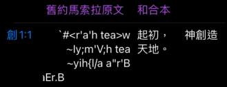

# 處理希伯來原文

- 為了在 ios 處理 離線版 的希伯來原文，要看下面幾個




[TOC]


### qsb.php

- umscode，就是指 Masoretic Text 瑪索拉文本
- ums: unicode ms
- umscode 定義在 code.php 中

```php!
<?php
require('enable_ajax.php');
require('../new/config.php');
require('dbconfig.php');
require('lang.php');
require('../new/code.php');
require('../new/hmfont.php'); //要處理羅馬拼音

// ' 變為 '' ， 是為了避免 SQL Injection
$chineses=str_replace("'","''",trim($_REQUEST['engs']));
$qstr=str_replace("'","''",trim($_REQUEST['qstr']));
$version=str_replace("'","''",trim($_REQUEST['version']));

// 預設值 (像有 3:21，它就沒有chineses，或寫 21，就沒有 chap)
if (strlen($version)==0) $version='nstrunv';
if ($chap<=0) $chap=1;
if (strlen($chineses)==0) $chineses='羅';

// 簡體中文，1
$GBCODE=(int) $_REQUEST['gb'];

// 是否要顯示 strong number 0 或 1
$strong=(int)$_REQUEST['strong'];

require('strong.php');

// gbbook 在 lang.php 中，它就是將各種表示書卷的英文，寫成中文(繁體)
// iconv 是 php 內建的函式, python 可用 chineses.encode('utf-8').decode('gb2312')
$tmp=gbbook($chineses);
if (strcmp($tmp,$chineses)==0 && $GBCODE==1)
    // 若是英文，就一定不成立。
    // 若是繁中，就會成立 第一條件。
    // TODO: 待確認，為何 php 有建議的 iconv，但卻還要另外寫 gb2bga.php 或 bg2gba.php ?
    // 已確認，原本是用 iconv，但轉換不好，所以後來大陸弟兄提供了 gb2bga.php 或 bg2gba.php。
    $chineses=gbbook(iconv('utf-8','gb2312',$chineses));
elseif ($GBCODE==1) $chineses=$tmp;

$db_conn=db_connect("dbname=$DBNAME");
db_set_encoding($db_conn,'utf-8');

// 先以 ; 分割
$stok=explode(';',$qstr);

// 開始回傳 json 的前面
echo '{'."\n";

$outmsg='';
$ocnt=0;
for ($i=0;$i<count($stok);$i++)
{
    // 可以看出，幾個 ; ，就會 select 幾次。

    // 從下文看 BLIMIT ，就是決定 chap 與 sec 條件的，我們看不到 where chap sec 的條件，因為這裡用 chap * 10000 + sec 這個數字來比較，也就是它假設不會有 chap 超過 1000 個 sec，這也是合理的假設。又因為，若換書卷，以 ; 分割，所以也不會出現跨書卷的問題。
    $BLIMIT='';

    // 消除多餘的空白
    $stok[$i]=trim($stok[$i]);

    // 無益義的，例如 qstr = Ro5:1;;Mt 1。
    if (strlen($stok[$i])==0) continue;

    // nowtok 就是其中一項，例如 Ro5:1
    $nowtok=$stok[$i];
    
    if (!is_numeric(substr($nowtok,0,1)))
        // 條件：第一個字元 不是數字
        // 這 chineses 是 query string ，表示為原本書卷預設值。
        // 例如 Ro5:1，若是 5:1 而已，就要用預設書卷(或是前一次出現的書卷，例如 Ro5:1;7:2)
        $chineses='';
    else if ($GBCODE==1)$chineses=$oldchineses;
    
    // 將文字略過，例如 `Ro 5:1`，變為` 5:1`
    while (!is_numeric(substr($nowtok,0,1)))
    {
       $chineses=$chineses.substr($nowtok,0,1);
       $nowtok=substr($nowtok,1);
    }

    $chineses=trim($chineses);
    // 供下次使用
    $oldchineses=$chineses;

    // 英文轉為簡體
    $tmp=gbbook($chineses);
    if (strcmp($tmp,$chineses)==0 && $GBCODE==1)
        $chineses=gbbook(iconv('utf-8','gb2312',$chineses));
    else $chineses=$tmp;

    // 各種情境 (5:1-3,5,7) (5:1-7:3) (2) ... 2 是整章，不是第2節 (規格中，沒有第2節)
    // 這裡要產生 BLIMIT 條件字串，它是由 chap sec 組成
    $pt=strpos($nowtok,':');
    $pcnt=substr_count($nowtok,':');
    $part4=0;
    if ($pcnt==2 && $pt!==false)
    {
        // 5:1-7:3 這種情境
        $beitem=explode('-',$nowtok);
        $barr=explode(':',$beitem[0]);
        $earr=explode(':',$beitem[1]);
        $bchap=(int)$barr[0];
        $bsec=(int)$barr[1];
        $echap=(int)$earr[0];
        $esec=(int)$earr[1];
        $bsco=$bchap*1000+$bsec;
        $esco=$echap*1000+$esec;
        $BLIMIT=$BLIMIT."or ( bible.chap*1000+bible.sec >= $bsco and bible.chap*1000+bible.sec <= $esco )";
	    $part4=1;
    }
    else if ($pt!==false)
    {
        // 5:1 或 5:1-3,5,7 或 1:1,4-6,7,8 這種情境
        $chap=(int)$nowtok;
        $secstr=substr($nowtok,$pt+1); # 留下 1 或 1-3,5,7 或 1,4-6,7,8
    }
    else
    {
        // 沒有 `:`，例如 `約二` or `約 5` or `約`
        // 其實信望愛沒有支援，只寫 節。當只有數字時，就是整章，若多個數字，例如 1-3,5,7，應該是要多節，但原程式 qsb.php 沒支援，所以這裡也沒支援。
        $chap=(int)$nowtok;
        $secstr='';
    }

    if ($part4==0)
    {
        // 第二種情況，第三種情況
        $BLIMIT='';
        if (strlen($secstr)>0)  //# mt 1:1-3,4,8
        {
            // 第二種情況
            if (strstr($secstr,','))
            {
                $tok = strtok ($secstr,',');
                $SLIMIT='';
                while (!($tok === FALSE)) // #mt 1:1,2,5,7
                {
                    if (strstr($tok,'-')) // #mt 1:1-3,6,10
                    {
                        $SLIMIT=$SLIMIT.parsed($tok);
                    }
                    else
                    {
                        $tok=(int) $tok;
                        $SLIMIT=$SLIMIT."or bible.sec=$tok ";
                    }
                    $tok = strtok (',');
                }
                $SLIMIT=substr($SLIMIT,2); //拿掉前面兩個字元 or
                $BLIMIT=$BLIMIT." or ( bible.chap=$chap and ( $SLIMIT ))";
            }
            elseif (strstr($secstr,"-"))
            {
                // 2:2-8 這種
                $tok = (int) strtok ($secstr,'-');
                $BLIMIT="or (bible.chap=$chap and (bible.sec>=$tok and ";
                $tok = (int) strtok ('-');
                $BLIMIT=$BLIMIT." bible.sec<=$tok))";
            }
            elseif ($secstr=='0')
            {
                $BLIMIT=$BLIMIT." or ( bible.chap=$chap )";
            }
            else 
            {
                // 2:1 這種
                $BLIMIT=$BLIMIT."or ( bible.chap=$chap and bible.sec=$secstr )";
            }
        } //sec >0
        else
        {
            // 整章
            $BLIMIT=$BLIMIT."or ( bible.chap=$chap )";
        }
    } //part4==0

    if (substr($chineses,0,1)=='#')
    {
        $chineses=substr($chineses,1);
    }

    $SQL="select main.chineses,bible.engs,bible.chap,bible.sec,bible.txt from $version as bible,main where bible.engs=main.engs and (main.chineses='${chineses}' or main.engs='${chineses}') and ( false  $BLIMIT ) order by bible.engs,bible.chap,bible.sec";

    $result=db_exec($db_conn,$SQL);
    if (!$result)
    {
    echo '"status":"Fail:'.$SQL.'"'."\n";
    die( '}');
    }
    $numrow=db_NumRows($result);
    $ocnt=$ocnt+$numrow;
    for ($ii=0;$ii<$numrow;$ii=$ii+1)
	{
		$ARAW=db_fetch_row($result,$ii);
		for ($j=0;$j<count($ARAW);$j++) $ARAW[$j]=trim($ARAW[$j]);
        
        if ($strong==0) $ARAW[4]=procstrong(0,$ARAW[4]);
		
        if ($proclist[$version]==3) # 羅馬拚音
		{
			$ARAW[4]=to_utf8($ARAW[4],0);
		}
        else if ($proclist[$version]==2) # 希伯來文
        {
            $ARAW[4]=umscode($ARAW[4]);
            # ms: Masoretic Text (瑪索拉文本)
            # ums: unicode ms
        }    
        else if ($proclist[$version]==1) # 希臘文
        {
            $ARAW[4]=gcode($ARAW[4],2);
            # gcode 定義在 code.php，是希臘文相關的處理
            # 參數 2 是 unicode 就回傳
        }
        else if ($version=='lxx') # 七十士譯本
        {
            $ARAW[4]=gcode($ARAW[4],2);
        }

		$outmsg=$outmsg.("{\"chineses\":".json_encode(trangb($ARAW[0])).",\"engs\":\"${ARAW[1]}\",\"chap\":${ARAW[2]},\"sec\":${ARAW[3]},\"bible_text\":".json_encode(trangb($ARAW[4]))."},");
	}
}

echo '"status":"success",'."\n";
echo '"record_count":'.$ocnt.','."\n";
$proc_lang=(int)$proclist[$version]; 
echo '"proc":'.$proc_lang.','."\n";
$outmsg=substr($outmsg,0,strlen($outmsg)-1);
$outmsg=str_replace("\r\n",'\n',$outmsg);
$outmsg=str_replace("\n",'\n',$outmsg);
echo('"record":['.$outmsg.']}');
	
function parsed($tok)
{
      $LIMIT='';
      $gtok=explode('-',$tok);
      //$gtok = strtok ($tok,"-");
      $gtok[0]=(int) $gtok[0];
      $gtok[1]=(int) $gtok[1];
      $LIMIT="or (bible.sec>=$gtok[0] and bible.sec<=$gtok[1]) ";
      return($LIMIT);
}

?>

```

### code.php
- 要看 umscode，如何處理 希伯來文本

```php!
<?php
$TP=array(
'n' => '名詞',
'v' => '動詞',
'a' => '形容詞',
'r' => '代名詞',
'rp' =>'人稱代名詞',
'rd' =>'指示代名詞',
'ri' =>'疑問代名詞',
'ai' =>'疑問形容詞',
'rr' =>'關係代名詞',
'ru' =>'不定代名詞',
'ra' =>'冠詞',
'c' => '連接詞',
'x' => '連接詞，助語字',
'i' => '感嘆詞',
'p' => '介系詞',
't' => '質詞',
'd' => '副詞',
'dr' => '關係副詞',
'drp' => '副詞加人稱代名詞',
'crp' => '連接詞加人稱代名詞',
'rre' =>'相互代名詞',
'rf' => '反身代名詞'
);
/******* 處理詞性 ******/
function de1($proid)
{
   global $TP;
   $pro=$TP[$proid] ;
   return $pro;
}
/******* 處理文法分析 ******/
function de2($proid,$pt2)
{
   /****處理parsing ******/
   $pt2=trim($pt2);
   $PC="";
   //Nouns and Pronouns (3 columns)
   if ((strcmp($proid,"n")==0)||  //名詞
       (strncmp($proid,"r",1)==0)||(strncmp($proid,'ai',2)==0)||(strcmp($proid,'drp')==0)||(strcmp($proid,'crp')==0)) //代名詞（冠詞不管了）
   {
      $c1=substr($pt2,0,1); //第一個字
      if (strcmp($c1,"n")==0) $PC=$PC."主格 ";
      elseif (strcmp($c1,"g")==0) $PC=$PC."所有格 ";
      elseif (strcmp($c1,"d")==0) $PC=$PC."間接受格 ";
      elseif (strcmp($c1,"a")==0) $PC=$PC."直接受格 ";
      elseif (strcmp($c1,"v")==0) $PC=$PC."呼格 ";
      else $PC=$PC." $c1 ";
      $c2=substr($pt2,1,1); //第二個字
      if (strcmp($c2,"s")==0) $PC=$PC."單數 ";
      elseif (strcmp($c2,"p")==0) $PC=$PC."複數 ";
      elseif (strcmp($c2,"d")==0) $PC=$PC."雙數 ";
      else $PC=$PC." $c2 ";
      $c3=substr($pt2,2,1); //第三個字
      if (strcmp($c3,"m")==0) $PC=$PC."陽性 ";
      elseif (strcmp($c3,"f")==0) $PC=$PC."陰性 ";
      elseif (strcmp($c3,"n")==0) $PC=$PC."中性 ";
      else $PC=$PC." $c3 ";
      $c4=substr($pt2,3,1); //第四個字
      if (strcmp($c4,"1")==0) $PC=$PC."第一人稱 ";
      elseif (strcmp($c4,"2")==0) $PC=$PC."第二人稱 ";
      elseif (strcmp($c4,"3")==0) $PC=$PC."第三人稱 ";
      else $PC=$PC." $c4 ";
   } //名詞與代名詞OK	
   if ((strcmp($proid,"v")==0))  //動詞
   {
      //What is Ptcpl
      $ptcp=0; //先假設不是分詞第一人稱
      $c1=substr($pt2,0,1); //第一個字
      if (strcmp($c1,"p")==0) $PC=$PC."現在 ";
      elseif (strcmp($c1,"i")==0) $PC=$PC."不完成 ";
      elseif (strcmp($c1,"f")==0) $PC=$PC."第一未來 ";
      elseif (strcmp($c1,"a")==0) $PC=$PC."第一簡單過去 ";
      elseif (strcmp($c1,"b")==0) $PC=$PC."第二簡單過去 ";
      elseif (strcmp($c1,"e")==0) $PC=$PC."過去 ";
      elseif (strcmp($c1,"x")==0) $PC=$PC."第一完成 ";
      elseif (strcmp($c1,"c")==0) $PC=$PC."第二完成 ";
      elseif (strcmp($c1,"y")==0) $PC=$PC."過去完成 ";
      elseif (strcmp($c1,"d")==0) $PC=$PC."完成 ";
      elseif (strcmp($c1,"g")==0) $PC=$PC."第二未來 ";
      else $PC=$PC." $c1 ";
      $c2=substr($pt2,1,1); //第二個字
      if (strcmp($c2,"a")==0) $PC=$PC."主動 ";
      elseif (strcmp($c2,"m")==0) $PC=$PC."關身 ";
      elseif (strcmp($c2,"p")==0) $PC=$PC."被動 ";
      elseif (strcmp($c2,"n")==0) $PC=$PC."關身形主動意 ";
      elseif (strcmp($c2,"o")==0) $PC=$PC."被動形主動意 ";
      elseif (strcmp($c2,'q')==0) $PC=$PC.'關身或被動 ';
      elseif (strcmp($c2,'r')==0) $PC=$PC.'關身或被動形主動意 ';
      else $PC=$PC." $c2 ";
      $c3=substr($pt2,2,1); //第三個字
      if (strcmp($c3,"i")==0) $PC=$PC."直說語氣 ";
      elseif (strcmp($c3,"d")==0) $PC=$PC."命令語氣 ";
      elseif (strcmp($c3,"s")==0) $PC=$PC."假設語氣 ";
      elseif (strcmp($c3,"o")==0) $PC=$PC."期望語氣 ";
      elseif (strcmp($c3,"n")==0) $PC=$PC."不定詞 ";
      elseif (strcmp($c3,"p")==0) 
	{	
		$PC=$PC."分詞 ";
		if (strlen($pt2)==6) //六個字就是第一人稱
		{
			$ptcp=1;
			//$PC=$PC."第一人稱 ";
		}
	}
      else $PC=$PC." $c3 ";
      if ($ptcp==1)
      {
	      	$c4=substr($pt2,3,1); //第四個字
       		if (strcmp($c4,"n")==0) $PC=$PC."主格 ";
      		elseif (strcmp($c4,"g")==0) $PC=$PC."所有格 ";
      		elseif (strcmp($c4,"d")==0) $PC=$PC."間接受格 ";
      		elseif (strcmp($c4,"a")==0) $PC=$PC."直接受格 ";
      		elseif (strcmp($c4,"v")==0) $PC=$PC."呼格 ";
      		else $PC=$PC." $c4 ";
      		$c5=substr($pt2,4,1); //第五個字
      		if (strcmp($c5,"s")==0) $PC=$PC."單數 ";
      		elseif (strcmp($c5,"p")==0) $PC=$PC."複數 ";
      		elseif (strcmp($c5,"d")==0) $PC=$PC."雙數 ";
      		else $PC=$PC." $c5 ";
      		$c6=substr($pt2,5,1); //第六個字
      		if (strcmp($c6,"m")==0) $PC=$PC."陽性 ";
      		elseif (strcmp($c6,"f")==0) $PC=$PC."陰性 ";
      		elseif (strcmp($c6,"n")==0) $PC=$PC."中性 ";
      		else $PC=$PC." $c6 ";
      }
      else  //不是分詞
      {
      	$c4=substr($pt2,3,1); //第四個字
      	if (strcmp($c4,"1")==0) $PC=$PC."第一人稱 ";
      	elseif (strcmp($c4,"2")==0) $PC=$PC."第二人稱 ";
      	elseif (strcmp($c4,"3")==0) $PC=$PC."第三人稱 ";
      	else $PC=$PC." $c4 ";
      	$c5=substr($pt2,4,1); //第五個字
      	if (strcmp($c5,"s")==0) $PC=$PC."單數 ";
      	elseif (strcmp($c5,"p")==0) $PC=$PC."複數 ";
      	elseif (strcmp($c5,"d")==0) $PC=$PC."雙數 ";
      	else $PC=$PC." $c5 ";
      }
   }
   if ((strcmp($proid,"a")==0)) //形容詞
   {
      $c1=substr($pt2,0,1); //第一個字
      if (strcmp($c1,"n")==0) $PC=$PC."主格 ";
      elseif (strcmp($c1,"g")==0) $PC=$PC."所有格 ";
      elseif (strcmp($c1,"d")==0) $PC=$PC."間接受格 ";
      elseif (strcmp($c1,"a")==0) $PC=$PC."直接受格 ";
      elseif (strcmp($c1,"v")==0) $PC=$PC."呼格 ";
      else $PC=$PC." $c1 ";
      $c2=substr($pt2,1,1); //第二個字
      if (strcmp($c2,"s")==0) $PC=$PC."單數 ";
      elseif (strcmp($c2,"p")==0) $PC=$PC."複數 ";
      elseif (strcmp($c2,"d")==0) $PC=$PC."雙數 ";
      else $PC=$PC." $c2 ";
      $c3=substr($pt2,2,1); //第三個字
      if (strcmp($c3,"m")==0) $PC=$PC."陽性 ";
      elseif (strcmp($c3,"f")==0) $PC=$PC."陰性 ";
      elseif (strcmp($c3,"n")==0) $PC=$PC."中性 ";
      else $PC=$PC." $c3 ";
      $c4=substr($pt2,3,1); //第四個字
      if (strcmp($c4,"c")==0) $PC=$PC."比較級 ";
      elseif (strcmp($c4,"s")==0) $PC=$PC."最高級 ";
      else $PC=$PC." $c4 ";
   } //形容詞OK	

   if (strlen(trim($PC))==0) $PC=$pt2;
   return $PC;
}
/*****[#5.3#]  輸出 §5.3  ******/
function hgarref($txt)
{
  $tmp=$txt;
 $newtxt="";
 while (!(($pt=strpos($tmp,'[#'))===false))
    {
        $ok1=substr($tmp,0,$pt);
        $newtxt=$newtxt.$ok1;
        $oldtmp=$tmp;
        $tmp=substr($tmp,$pt+2); //確保12在21之前
        $pt1=strpos($tmp,'#]');
        if ($pt1==0)
        {
           //echo "error in WEBhebpar $tmp <br>";
           //return;
           $tmp=$oldtmp;
           break;
        }
        $heb=substr($tmp,0,$pt1);
	$heb=str_replace('１','1',$heb);
        $heb=str_replace('２','2',$heb);
        $heb=str_replace('３','3',$heb);
        $heb=str_replace('４','4',$heb);
        $heb=str_replace('５','5',$heb);
        $heb=str_replace('６','6',$heb);
        $heb=str_replace('７','7',$heb);
        $heb=str_replace('８','8',$heb);
        $heb=str_replace('９','9',$heb);
        $heb=str_replace('．','.',$heb);
        //$newtxt=$newtxt.'看希伯來文讀經§'.$heb.'。';
        $newtxt=$newtxt.'§'.$heb;
        $tmp=substr($tmp,$pt1+2);
    }
    $newtxt=$newtxt.$tmp;
    $newtxt;

  return($newtxt);
}
/*****<! !> 輸出 Cross Walk的希臘文字型輸出到網頁用 ******/
function grkpar($txt,$graph)
{
  $tmp=$txt;
 $newtxt="";
 $ns=chr(34);
 while (!(($pt=strpos($tmp,"<!"))===false))
    {
        $ok1=substr($tmp,0,$pt);
        $newtxt=$newtxt.$ok1;
        $pt1=strpos($tmp,"!>");
        if ($pt1==0)
        {
           echo "error in WEB Greek parsing $tmp lost !&gt;<br>";
           return;
        }
        $grk=substr($tmp,$pt+2,$pt1-$pt-2);
        if ($graph==1)
        {
          $grk=gfont(gcode($grk,1));
          $newtxt=$newtxt.$grk;
        }
	if ($graph==2)
        {
          $grk=htmlspecialchars(gcode($grk,2));
          $newtxt=$newtxt."<!".$grk."!>";
        }
      
        else
        {
          $grk=htmlspecialchars(gcode($grk,0));
          $newtxt=$newtxt."<!".$grk."!>";
        }
        $tmp=substr($tmp,$pt1+2);
    }
    $newtxt=$newtxt.$tmp;
    $txt=$newtxt;
  if ($graph==0)
  {
    $txt=str_replace('<!','<font class="g1"><nobr>',$txt);
    $txt=str_replace('!>','</nobr></font>',$txt);
  }
  return($txt);
}
/*****12 21 輸出 COBS的字型輸出到網頁用 ******/
function hebpar($txt,$graph)
{
  $tmp=$txt;
 $newtxt="";
 while (!(($pt=strpos($tmp,"12"))===false))
    {
        $ok1=substr($tmp,0,$pt);
        $newtxt=$newtxt.$ok1;
	$oldtmp=$tmp;
        $tmp=substr($tmp,$pt+2); //確保 12 一定在 21前面
        $pt1=strpos($tmp,"21");
        if ($pt1==0)
        {
           //echo "error in WEBhebpar $tmp <br>";
           //return;
	   $tmp=$oldtmp;
	   break;
        }
        $heb=substr($tmp,0,$pt1);
        if ($graph ==2)
        {
          $heb=htmlspecialchars(umscode($heb));
          $newtxt=$newtxt."{#".$heb."#}";
        }
        else if ($graph ==1)
        {
          $heb=pfont(mscode($heb));
          $newtxt=$newtxt.$heb;
        }
        else 
        {
          $heb=htmlspecialchars($heb);
          $newtxt=$newtxt."{#".$heb."#}";
        }
        $tmp=substr($tmp,$pt1+2);
    }
    $newtxt=$newtxt.$tmp;
    $txt=$newtxt;
  if ($graph==0)
  {
    $txt=str_replace('{#','<font class="g2"><nobr>',$txt);
    $txt=str_replace('#}','</nobr></font>',$txt);
  }
  else if ($graph==2)
  {
    //$txt=str_replace('{#','<div style="display: inline-block;white-space: nowrap;">',$txt);
    //$txt=str_replace('#}','</div>',$txt);
    $txt=str_replace('{#','',$txt);
    $txt=str_replace('#}','',$txt);
  }
  $txt=str_replace('１２','12',$txt);
  $txt=str_replace('２１','21',$txt);
  return($txt);
}

/*****{!  !} 輸出 Hebrew Translate 的字型輸出到網頁用 ******/
function hebtranpar($txt,$graph)
{
  $tmp=$txt;
 $newtxt="";
 while (!(($pt=strpos($tmp,"{!"))===false))
    {
        $ok1=substr($tmp,0,$pt);
        $newtxt=$newtxt.$ok1;
        $pt1=strpos($tmp,"!}");
        if ($pt1==0)
        {
           echo "error in hebtranpar $tmp need !} <br>";
           return;
        }
        $heb=substr($tmp,$pt+2,$pt1-$pt-2);
	/*********
        if ($graph)
        {
          $heb=htfont($heb);
          $newtxt=$newtxt.$heb;
        }
        else
        *********/
        {
          $heb=htmlspecialchars($heb);
          $newtxt=$newtxt."{!".$heb."!}";
        }
        $tmp=substr($tmp,$pt1+2);
    }
    $newtxt=$newtxt.$tmp;
    $txt=$newtxt;
  if ($graph==0)
  {
    $txt=str_replace('{!','<font face="Hebrew Transliterate"><nobr>',$txt);
    $txt=str_replace('!}','</nobr></font>',$txt);
  }
  return($txt);
}

function umscode($txt)
{
$A=array(34, 60, 62, 63, 58,  69, 73, 79, 85, 92,125);//瘦母音
$B=array(39, 44, 46, 47, 59, 101,105,111,117,124, 93);//胖母音
$C=array(161,162,163,164,165,166,167,111,168,169,170);//右母音
	//70,76,102,108專配 123，瘦子音配79，胖子音配111。 
$M=array(34, 60, 62, 63, 58,  69, 73, 79, 85, 92,125,
	 39, 44, 46, 47, 59, 101,105,111,117,124, 93,
	 161,162,163,164,165,166,167,123,168,169,170); //母音全集
$TS=array(33,65,71,78,87,89,90,103,110,119,121,122);//瘦子音 配 $A
$SS=array(68,82,100,114);//畸形子音應該要配「右母音」 $C
$FS=array(35,36,37,38,64,94,66,67,70,72,74,75,76,77,80,81,83,84,86,
	  88,91,97,98,99,102,104,106,107,108,109,112,113,115,116,117,
          118,120,126); //胖子音配 $B
$S=array(33,65,71,78,87,89,90,103,110,119,121,122,
	 68,82,100,114,
	 35,36,37,38,64,94,66,67,70,72,74,75,76,77,80,81,83,84,86,
          88,91,97,98,99,102,104,106,107,108,109,112,113,115,116,117,
          118,120,126,96);//子音全集
$UTS=array('ן','וֹ','גּ','נּ','וּ','יּ','זּ','ג','נ','ו','י','ז');
$USS=array('דּ','רּ','ד','ר');
$UFS=array('ץ','ך','ךְ','ךּ','ף','ךָ','בּ','צּ','שּׂ','הּ','טּ','כּ','לּ','מּ','פּ','קּ'
           ,'סּ','תּ','שּׁ','ש','ע','א','ב','צ','שׂ','ה','ט','כ','ל','מ',
           'פ','ק','ס','ת','','שׁ','ח','ם');
$US=array('ן','וֹ','גּ','נּ','וּ','יּ','זּ','ג','נ','ו','י','ז',
'דּ','רּ','ד','ר',
'ץ','ך','ךְ','ךּ','ף','ךָ','בּ','צּ','שּׂ','הּ','טּ','כּ','לּ','מּ','פּ','קּ'
           ,'סּ','תּ','שּׁ','ש','ע','א','ב','צ','שׂ','ה','ט','כ','ל','מ',
           'פ','ק','ס','ת','','שׁ','ח','ם','׃');
/*******
$UA=array(mb_convert_encoding('&#1464;', 'utf-8', 'html-entities'),mb_convert_encoding('&#1462;', 'utf-8', 'html-entities'),
mb_convert_encoding('&#1456;', 'utf-8', 'html-entities'),mb_convert_encoding('&#1457;', 'utf-8', 'html-entities'),
mb_convert_encoding('&#1463;', 'utf-8', 'html-entities'),mb_convert_encoding('&#1461;', 'utf-8', 'html-entities'),
mb_convert_encoding('&#1460;', 'utf-8', 'html-entities'),mb_convert_encoding('&#1465;', 'utf-8', 'html-entities'),
mb_convert_encoding('&#1467;', 'utf-8', 'html-entities'),mb_convert_encoding('&#1459;', 'utf-8', 'html-entities'),
mb_convert_encoding('&#1458;', 'utf-8', 'html-entities'));
********/
$UA=array('ָ','ֶ','ְ','ֱ','ַ','ֵ','ִ','ֹ','ֻ','ֳ','ֲ');

   $len=strlen($txt);
   $ntxt="";
    for ($pt=0;$pt<$len;$pt=$pt+1)
    {
        $now=substr($txt,$pt,1);
	$cx=ord($now);
	if (in_array($cx,$M))
	{
	   $aid=array_search($cx,$M);
	   $aid=$aid%11;//算出這是十一個母音中的第幾個
	   $ntxt=$UA[$aid].$ntxt;
	}
	else if(in_array($cx,$S))
	{

		$sid=array_search($cx,$S);
		$ntxt=$US[$sid].$ntxt;
	}
        else //不必處理
                $ntxt=$now.$ntxt;
    }
    /****結束符號******/
    return($ntxt);
}
/***********母音與子音之搭配 *************************/
function mscode($txt)
{
$A=array(34, 60, 62, 63, 58,  69, 73, 79, 85, 92,125);//瘦母音
$B=array(39, 44, 46, 47, 59, 101,105,111,117,124, 93);//胖母音
$C=array(161,162,163,164,165,166,167,111,168,169,170);//右母音
	//70,76,102,108專配 123，瘦子音配79，胖子音配111。 
$M=array(34, 60, 62, 63, 58,  69, 73, 79, 85, 92,125,
	 39, 44, 46, 47, 59, 101,105,111,117,124, 93,
	 161,162,163,164,165,166,167,123,168,169,170); //母音全集
$TS=array(33,65,71,78,87,89,90,103,110,119,121,122);//瘦子音 配 $A
$SS=array(68,82,100,114);//畸形子音應該要配「右母音」 $C
$FS=array(35,36,37,38,64,94,66,67,70,72,74,75,76,77,80,81,83,84,86,
	  88,91,97,98,99,102,104,106,107,108,109,112,113,115,116,117,
          118,120,126); //胖子音配 $B
$S=array(33,65,71,78,87,89,90,103,110,119,121,122,
	 68,82,100,114,
	 35,36,37,38,64,94,66,67,70,72,74,75,76,77,80,81,83,84,86,
          88,91,97,98,99,102,104,106,107,108,109,112,113,115,116,117,
          118,120,126);//子音全集
   $len=strlen($txt);
    if ($len==0) return($txt);
    $ntxt="";
    for ($pt=0;$pt<$len;$pt=$pt+1)
    {
        $now=substr($txt,$pt,1);
	$cn=ord($now);
        if ($pt<($len-1)) //look ahead不可以讓系統超過字串最後
	{
                $next=substr($txt,$pt+1,1);
		$cx=ord($next);
	}
        else
	{
                $next=""; //空字串不會在陣列中
		$cx=0;
	}
        if (in_array($cn,$M)&&in_array($cx,$S)) //母音加子音，需要處理
        {
		$aid=array_search($cn,$M);
		$aid=$aid%11;//算出這是十一個母音中的第幾個
		//看看是什麼子音
		if (in_array($cx,$FS)) //胖子音
		{
			//70,76,102,108專配 123，瘦子音配79，胖子音配111。 
			//70,76,102,108 是胖子音
			if ((($cx==70)||($cx==76)||($cx==102)||($cx==108))
			   && (($cn==123)||($cn==79)||($cn==111)))
			   {
				$ntxt=$ntxt.chr(123).$next;
			   }
			else
                	   $ntxt=$ntxt.chr($B[$aid]).$next;
		}
		elseif (in_array($cx,$TS)) //瘦子音
		{
                	$ntxt=$ntxt.chr($A[$aid]).$next;
		}
		elseif (in_array($cx,$SS)) //畸形子音
		{
                	$ntxt=$ntxt.chr($C[$aid]).$next;
		}
		else
		{
			 echogb("沒有 $next 這個子音");
			 die('');
		}
                $pt=$pt+1;
	 }
        else //不必處理
        {
                $ntxt=$ntxt.$now;
        }
    }
    $endmark=chr(96);
    /****耶路撒冷 ******************************/
    $nyes=chr(167)."~;l'vWr>y";
    $ntxt=str_replace("i~;l'vWr>y",$nyes,$ntxt);
    $nyes=chr(167)."~'l'vWryIw";
    $ntxt=str_replace("i~'l'vWryIw",$nyes,$ntxt);
    $nyes=chr(167)."~;l'vWryIw";
    $ntxt=str_replace("i~;l'vWryIw",$nyes,$ntxt);
    /******特殊的母音*******/
    $yes="(-;H)";
    $nyes="-".chr(165).chr(72);
    $ntxt=str_replace($yes,$nyes,$ntxt);
    $yes="(^;H)";
    $nyes=chr(165).chr(72);
    $ntxt=str_replace($yes,$nyes,$ntxt);
    $yes="( ;H)";
    $nyes=" ".chr(165)."H";
    $ntxt=str_replace($yes,$nyes,$ntxt);
    $yes="(\n;H)";
    $nyes="\n".chr(165)."H";
    $ntxt=str_replace($yes,$nyes,$ntxt);
    $yes="({$endmark};H)";
    $nyes="$endmark".chr(165)."H";
    $ntxt=str_replace($yes,$nyes,$ntxt);

    $yes="-;\[";
    $nyes="-".chr(165).chr(91);
    $ntxt=str_replace($yes,$nyes,$ntxt);
    $yes="^;\[";
    $nyes=chr(165).chr(91);
    $ntxt=str_replace($yes,$nyes,$ntxt);
    $yes=" ;\[";
    $nyes=" ".chr(165).chr(91);
    $ntxt=str_replace($yes,$nyes,$ntxt);
    $yes="\n;\[";
    $nyes="\n".chr(165).chr(91);
    $ntxt=str_replace($yes,$nyes,$ntxt);
    $yes="{$endmark};\[";
    $nyes="$endmark".chr(165).chr(91);
    $ntxt=str_replace($yes,$nyes,$ntxt);

    $yes="(-;x)";
    $nyes="-".chr(165)."x";
    $ntxt=str_replace($yes,$nyes,$ntxt);
    $yes="(^;x)";
    $nyes=chr(165)."x";
    $ntxt=str_replace($yes,$nyes,$ntxt);
    $yes="( ;x)";
    $nyes=" ".chr(165)."x";
    $ntxt=str_replace($yes,$nyes,$ntxt);
    $yes="(\n;x)";
    $nyes="\n".chr(165)."x";
    $ntxt=str_replace($yes,$nyes,$ntxt);
    $endmark=chr(96);
    $yes="({$endmark};x)";
    $nyes="$endmark".chr(165)."x";
    $ntxt=str_replace($yes,$nyes,$ntxt);
    /****結束符號******/
    return($ntxt);
}
function gcode($itxt,$graph)
{
 $iepuno=array(118, 59,106, 74, 39, 92,124, 91, 93, 38, 94);
 //$iepunn=array( 17, 18, 19, 20, 21, 22, 23, 28, 29, 30, 31);
 $iepunn=array(161,162,163,164,165,166,167,168,169,170,171);
 $Bpuno=array(106, 74, 92,124, 91, 93, 38, 94);
 $Bpunn=array( 36, 37, 42, 43,126, 60, 33, 64);
 //$Bpunn=array(179,180,182,183,184,185,186,187);
 $BList=array('A','I','E','U','H','O','W','R');
  $orgb=array( //must to be remove error punn
             'Aj/','Hj/','Wj/','a$/','h$/','w$/',
             'AJ/','HJ/','WJ/','a%/','h%/','w%/',
             'A]/','H]/','W]/','a</','h</','w</',
             'A^/','H^/','W^/','a@/','h@/','w@/',
             'A[/','H[/','W[/','a~/','h~/','w~/',
             'A&/','H&/','W&/','a!/','h!/','w!/',
             'A\\/','H\\/','W\\/','a*/','h*/','w*/',
             'A|/','H|/','W|/','a+/','h+/','w+/',
             'a;/','h;/','w;/',
             'A/','H/','W/','a/','h/','w/',
             "a'/","h'/","w'/","av/","hv/","wv/",
             'A&','E&','H&','I&','O&','U&','W&','a!','e!','h!','i!','o!','u!','w!',
             "a'","h'","i'","u'","w'",
             'a;','e;','h;','i;','o;','u;','w;',
             'i>','u>','i?','u?',
             'AJ','EJ','HJ','IJ','OJ','UJ','WJ','RJ','a%','e%','h%','i%','o%','u%','w%','r%',
             'A[','E[','H[','I[','O[','U[','W[','a~','e~','h~','i~','o~','u~','w~',
             'A\\','E\\','H\\','I\\','O\\','U\\','W\\','a*','e*','h*','i*','o*','u*','w*',
             'A]','E]','H]','I]','O]','U]','W]','a<','e<','h<','i<','o<','u<','w<',
             'A^','E^','H^','I^','O^','U^','W^','a@','e@','h@','i@','o@','u@','w@',
             'Aj','Ej','Hj','Ij','Oj','Wj','a$','e$','h$','i$','o$','u$','w$',
             'Aj','Ej','Hj','Ij','Oj','Wj',
             'av','ev','hv','iv','ov','uv','wv',
             'A|','E|','H|','I|','O|','U|','W|','a+','e+','h+','i+','o+','u+','w+',
             'i:','u:'
             );
 $orga=array(
             'A$/','H$/','W$/','aj/','hj/','wj/',
             'A%/','H%/','W%/','aJ/','hJ/','wJ/',
             'A</','H</','W</','a]/','h]/','w]/',
             'A@/','H@/','W@/','a^/','h^/','w^/',
             'A~/','H~/','W~/','a[/','h[/','w[/',
             'A!/','H!/','W!/','a&/','h&/','w&/',
             'A*/','H*/','W*/','a\\/','h\\/','w\\/',
             'A+/','H+/','W+/','a|/','h|/','w|/',
             'a;/','h;/','w;/',
             'A/','H/','W/','a/','h/','w/',
             'av/','hv/','wv/',"a'/","h'/","w'/",
             'A!','E!','H!','I!','O!','U!','W!','a&','e&','h&','i&','o&','u&','w&',
             "a'","h'","i'","u'","w'",
             'a;','e;','h;','i;','o;','u;','w;',
             'i>','u>','i?','u?',
             'A%','E%','H%','I%','O%','U%','W%','R%','aJ','eJ','hJ','iJ','oJ','uJ','wJ','rJ',
             'A~','E~','H~','I~','O~','U~','W~','a[','e[','h[','i[','o[','u[','w[',
             'A*','E*','H*','I*','O*','U*','W*','a\\','e\\','h\\','i\\','o\\','u\\','w\\',
             'A<','E<','H<','I<','O<','U<','W<','a]','e]','h]','i]','o]','u]','w]',
             'A@','E@','H@','I@','O@','U@','W@','a^','e^','h^','i^','o^','u^','w^',
             'A$','E$','H$','I$','O$','W$','aj','ej','hj','ij','oj','uj','wj',
             'Aj','Ej','Hj','Ij','Oj','Wj',
             'av','ev','hv','iv','ov','uv','wv',
             'A+','E+','H+','I+','O+','U+','W+','a|','e|','h|','i|','o|','u|','w|',
             'i:','u:'
             );

  $AD=array('"','#','{','}',
           'A','B','C','D','E','F','G','H','I','K','L','M','N','O','P','Q','R','S','T','U','V','W','X','Y','Z','`',
           'a','b','c','d','e','f','g','h','i','k','l','m','n','o','p','q','r','s','t','u','w','x','y','z');
  $UAD=array('ς','᾽','·',';',
 'Α','Β','Χ','Δ','Ε','Φ','Γ','Η','Ι','Κ','Λ','Μ','Ν','Ο','Π','Θ','Ρ','Σ','Τ','Υ','´','Ω','Ξ','Ψ','Ζ','`',
 'α','β','χ','δ','ε','φ','γ','η','ι','κ','λ','μ','ν','ο','π','θ','ρ','σ','τ','υ','ω','ξ','ψ','ζ');
  $uorg=array(
             'ᾈ','ᾘ','ᾨ','ᾀ','ᾐ','ᾠ',
             'ᾉ','ᾙ','ᾩ','ᾁ','ᾑ','ᾡ',
             'ᾊ','ᾚ','ᾪ','ᾂ','ᾒ','ᾢ',
             'ᾋ','ᾛ','ᾫ','ᾃ','ᾓ','ᾣ',
             'ᾌ','ᾜ','ᾬ','ᾄ','ᾔ','ᾤ',
             'ᾍ','ᾝ','ᾭ','ᾅ','ᾕ','ᾥ',
             'ᾎ','ᾞ','ᾮ','ᾆ','ᾖ','ᾦ',
             'ᾏ','ᾟ','ᾯ','ᾇ','ᾗ','ᾧ',
             'ᾲ','ῂ','ῲ',
             'ᾼ','ῌ','ῼ','ᾳ','ῃ','ῳ',
             'ᾴ','ῄ','ῴ','ᾷ','ῇ','ῷ',
             'Ἅ','Ἕ','Ἥ','Ἵ','Ὅ','Ὕ','Ὥ','ἅ','ἕ','ἥ','ἵ','ὅ','ὕ','ὥ',
             'ᾶ','ῆ','ῖ','ῦ','ῶ',
             'ὰ','ὲ','ὴ','ὶ','ὸ','ὺ','ὼ',
             'ϊ','ϋ','ΐ','ΰ',
             'Ἁ','Ἑ','Ἡ','Ἱ','Ὁ','Ὑ','Ὡ','Ῥ','ἁ','ἑ','ἡ','ἱ','ὁ','ὑ','ὡ','ῥ',
             'Ἄ','Ἔ','Ἤ','Ἴ','Ὄ','὜','Ὤ','ἄ','ἔ','ἤ','ἴ','ὄ','ὔ','ὤ',
             'Ἆ','἞','Ἦ','Ἶ','὎','὞','Ὦ','ἆ','἖','ἦ','ἶ','὆','ὖ','ὦ',
             'Ἂ','Ἒ','Ἢ','Ἲ','Ὂ','὚','Ὢ','ἂ','ἒ','ἢ','ἲ','ὂ','ὒ','ὢ',
             'Ἃ','Ἓ','Ἣ','Ἳ','Ὃ','Ὓ','Ὣ','ἃ','ἓ','ἣ','ἳ','ὃ','ὓ','ὣ',
             'Ἀ','Ἐ','Ἠ','Ἰ','Ὀ',    'Ὠ','ἀ','ἐ','ἠ','ἰ','ὀ','ὐ','ὠ',
         'Ἀ','Ἐ','Ἠ','Ἰ','Ὀ',    'Ὠ',
             'ά','έ','ή','ί','ό','ύ','ώ',
             'Ἇ','἟','Ἧ','Ἷ','὏','Ὗ','Ὧ','ἇ','἗','ἧ','ἷ','὇','ὗ','ὧ',
             'ῒ','ῢ'
             );

 $len=strlen($itxt);
 if ($len==0) return($itxt);
 /***** Process line end 's' of Greek *****/
 $ns=chr(34);
 $txt=preg_replace("/s([-\r\n,.:;}{) ])/","{$ns}\\1",$itxt);
 $txt=preg_replace('/s$/',$ns,$txt);

 if ($graph==2)//unicode
 {
        $ntxt=str_replace($orga,$uorg,$txt);
        $ntxt=str_replace($orgb,$uorg,$ntxt);
        $ntxt=str_replace($AD,$UAD,$ntxt);
        return $ntxt;
 }

 /**** 處理重音與氣號 ***/
 $ntxt=substr($txt,0,1);//第一個字
 for ($pt=1;$pt<$len;$pt=$pt+1)//重音不會放在一開頭
 {
        $flag=0;
        $now=substr($txt,$pt,1);
        $key=array_search(ord($now), $iepuno);
        if ($key!==false && $graph==1)
        {
                $pre=substr($txt,$pt-1,1);
                if (strcmp($pre,'i')==0||strcmp($pre,'e')==0) //match
		{
                        $ntxt=$ntxt.chr($iepunn[$key]);
                	$flag=1;
		}
        }
         $key=array_search(ord($now), $Bpuno);
        if ($key!==false && $flag==0)
        {
                $pre=substr($txt,$pt-1,1);
                if (in_array($pre,$BList)) //match
		{
                        $ntxt=$ntxt.chr($Bpunn[$key]);
                	$flag=1;
		}
        }
        if ($flag==0) $ntxt=$ntxt.$now;
 }//for pt
 return $ntxt;
}

?>

```

### z240703a.py
- 這個是當時作 nuilocal 時作的
- 也是在了解上面2個，作了很多注解

```python!
#%%
# import 
if __name__ == "__main__":
    from add_parent_dir_to_sys_path import set_cwd_and_add_parent_dir_to_sys_path_callme_initially
    set_cwd_and_add_parent_dir_to_sys_path_callme_initially()
from PyCommon import *  
from hmfont_constants1 import *
from hmfont_constants2 import *

def process_strong(bible_text:str, strong: 0|1)->str:
    if strong == 1:
        raise NotImplementedError("Not implemented yet")
    
    def process_remove_strong(bible_text):
        """
        
        - 先找 `<` 的位置，若找不到 `>` ， 則回傳錯誤。
        - 找到 `<` 的位置，確認有沒有 `{<` 一起出現。因為這是 `{<WG23>}` 這種情境
        - 出現 `{<` 時，不一定有 `>}`，這種情境很特別，我還不知道哪段經文，哪個譯本有。但這原因出於，這大括號，其是是中文的大括號，不是我們理解的 `{<` 那個大括號。
        
        """
        tmp = bible_text
        bibletxt = ""
        
        while "<" in tmp:
            pt = tmp.find("<")
            ok = tmp[:pt]
            
            # pt>0 是小雪加的, 考慮 `<WG23>` 的<在第一個字元 
            if pt>0 and ok[-1] == "{":
                bok = ok[-1] # 即 `{` 字元
                ok = ok[:-1] # 拿掉最後一個字元
                quoted = 1 # quoted 的中文是 引號
            else:
                quoted = 0

            bibletxt += ok

            # 若是遇以下這些，則不要省略，要保留著。
            ntmp = tmp[pt:pt+3]
            fg = 0
            if ntmp.startswith("<h") or ntmp.startswith("<u") or ntmp == "</u" or ntmp == "</h" or ntmp == "<br" or ntmp == "<b" or ntmp == "</b":
                fg = 1

            pt1 = tmp.find(">")
            if pt1 == 0:
                # 應該要成對出現的，卻沒有不合理。
                print("error in strong number parsing", bible_text)
                return

            if fg == 1:
                # 將 <br> 這些標籤加回去
                # tmp[pt:pt1+1] 就是 `<br>` 這種標籤
                if quoted:
                    bibletxt += bok # 就是那麼巧，是 `{<br>` 這種，所以把 { 加回去，它不是要省略的
                bibletxt += tmp[pt:pt1+1]
                
                tmp = tmp[pt1+1:] # 進入 next while loop
            else:
                if tmp[pt1+1] == "}":
                    # 這是 `{<WG23>}` 這種情境
                    tmp = tmp[pt1+2:]
                else:
                    # 這是 `{<WG23>臨....}` 這種情境，那個大括號不是與 < 一起的。
                    if quoted:
                        bibletxt += bok # 將 `{` 加回去
                    
                    tmp = tmp[pt1+1:]

        bibletxt += tmp # 最後，將 tmp 加回去
        return bibletxt
        
    return process_remove_strong (bible_text)
    

def process_bible_text(bible_text_from_sql:str, version: str, strong: 0|1, proclist: 0|1|2|3)->str:
    def procstrong0(text:str)->str:
        # 將 {<WG...>} 或 <WG...> 移除，但卻不移除 <br><u> 之類的標籤
        return process_strong(text, 0)
    
    def procProcList_3_utf8(text:str)->str:
        # 羅馬拚音，像台語、客語，就可能用到
        def to_utf8(bys_utf8,graph=0):
            graph = 0
            padd = ['gif','jpg','png','doc','ppt','mp3','a','ms','loop']
            ans = ""
            tok = [] # ""
            
            # 主流程，在 while(len(txt) > 0) 開始
            # do_tok ... 呼叫 par_ro 
            
            def is_alpha_or_digit(ord, len_tok):
                # 這個函數是用來判斷是否是英文或數字
                # ascii 48-57 是數字，65-90 是大寫英文，97-122 是小寫英文
                # 例如 u5be6，所以才會出現，數字不可能在第1個字元的條件式
                return (len_tok > 0 and ord >= 48 and ord <= 57) or (ord >= 65 and ord <= 90) or (ord >= 97 and ord <= 122)
            def tran_utf8(word):
                if len(word[1]) == 0:
                    return word # 沒有母音
                
                if len(word[1]) == 1:
                    mpt = 0
                elif word[1].lower().startswith('im'):
                    mpt = 0 # erase im in
                elif word[1].lower().startswith('in'):
                    mpt = 0
                elif word[1].lower().startswith('ii'):
                    mpt = 0 # add by tjm for Hakka
                # elif word[1].lower().startswith('i') and int(word[1][1]) == 0:
                elif word[1].lower() == 'i':
                    mpt = 1
                else:
                    mpt = 0
                    
                # 處理鼻音
                strr = word[1] # php 變數是 str, 但 python str 是個保留字，所以改成 strr
                if strr[-1] == 'N':
                    pad = map_utf8['nn']
                    strr = strr[:-1]
                elif strr[-2:] == 'nn':
                    pad = map_utf8['nn']
                    strr = strr[:-2]
                else:
                    pad = ''
                
                nstr = ''
                cnt = 0                    
                cnt_mon = len(mon)
                cnt_mson = len(mson)
                mstak = [] # 例如 ['i','n']
                mscnt = 0
                while len(strr) > 0:
                    is_goto_while = False
                    for i in range(2, cnt_mon): # 處理純母音, 從2開始，因為 0,1 是 nn, N 上面處理過的鼻音
                        code = mon[i]
                        if strr.startswith(code):
                            if cnt == mpt:
                                mstak.append(code) # 加聲調
                                mscnt += 1
                            else:
                                mstak.append(code)
                                mscnt += 1
                            strr = strr[len(code):]
                            cnt += 1
                            is_goto_while = True
                            break
                    if is_goto_while:
                        continue # while len > 0
                    
                    # 處理母子音共用
                    for i in range(0, cnt_mson):
                        code = mson[i]
                        ngpad = ''
                        if strr.startswith(code):
                            if cnt == mpt: #加聲調
                                mstak.append(code)
                                mscnt += 1
                            else:
                                mstak.append(code)
                                mscnt += 1
                            strr = strr[len(code):]
                            cnt += 1
                            is_goto_while = True
                            break
                    if is_goto_while:
                        continue # while len > 0
                    
                    print("error in ", strr)
                    strr = strr[1:]
                
                maxs = -3
                maxpt = 0
                nstr = ''
                ngpad = ''
                if mscnt == 1:
                    maxpt = 0
                elif mscnt > 1:
                    maxpt = 1
                    if mstak[1] in ['i', 'I', 'ng', 'NG', 'Ng', 'm', 'M', 'n', 'N']:
                        maxpt = 0
                    for i in range(mscnt):
                        if mstak[i] in ['a', 'A']:
                            maxpt = i
                    if word[2] == '' and maxpt >= 1 and mscnt == 2 and (mstak[maxpt-1] == 'o' or mstak[maxpt-1] == 'O') and (mstak[maxpt] == 'e' or mstak[maxpt] == 'E' or mstak[maxpt] == 'a' or mstak[maxpt] == 'A'):
                        maxpt = maxpt - 1
                for i in range(mscnt):
                    code = mstak[i]
                    if i == maxpt: # add 1234
                        if code.lower() == 'ng' and word[3] > 0: # ng3 to n3g
                            sear = code[0] + f"{word[3]}"
                            ngpad = code[1]
                        else:
                            sear = code + f"{word[3]}" # word[3] 是幾聲，例如 o3 
                    else:
                        sear = code
                    
                    nstr += map_utf8.get(sear, code)    
                    
                word[1] = nstr + ngpad + pad
                
                return word
            def par_ro(bys: bytearray):
                # 此 input ， 就是 while loop 中的 tok， 就是每個字元符合條件，連續串在一起的字元。
                global mon, son, mson, tail, sound, word
                status = 1 # result 1:ok, 0:error
                word = ['','','',0] # result ， 每個羅馬拚音，有4部分，子音，母音，入聲字尾，調號，。(一定會有母音[1])…也對應全域變數 son mon tail sound。
                
                def trimSpace(bys:bytearray)->bytearray:
                    # ascii 中 32 是空白, 9 是 tab, 10 是換行, 13 是回車, 160 是不間斷空白
                    r1 = lq.linq(bys).skip_while(lambda x: x in [32, 9, 10, 13, 160]).to_list()
                    r2 = lq.linq(r1).reverse().skip_while(lambda x: x in [32, 9, 10, 13, 160]).reverse().to_list()
                    return bytearray( r2 )
                
                # 去除空白 trim
                bys:bytearray = trimSpace(bys) # bys = bys.strip()
                lenn = len(bys)
                if lenn == 0:
                    return 0, ['', '', '', 0]
                
                # 鼻音N或nn
	            # 一個羅馬拼音是由 [子音]母音[入聲尾][調號] 組成，一定有母音
                # mode = 0：表示程式目前處於檢查母子音共用的階段。
                # mode = 1：表示程式目前處於檢查母音的階段。
                # mode = 2：表示程式目前處於檢查入聲詞尾的階段。
                # mode = 3：表示程式目前處於檢查調號的階段。             
                mode = 0
                pt = 0
                tmpmon = ''
                bktmpmon = ''
                while lenn > 0:
                    is_goto_while = False
                    if mode == 0:
                        for code in mson:
                            if bys.decode('utf-8').startswith(code):
                            # if bys.startswith(code):
                                word[mode] = word[mode] + code
                                bys = bys[len(code):] # 可以，因為 code 都是英文與數字，都 < 0x80
                                lenn = lenn - len(code)
                                tmpmon = code
                                mode = 1
                                is_goto_while = True
                                break
                        if is_goto_while:
                            continue # while len > 0 
                        for code in son:
                            # php: if (strncasecmp($str,$code,strlen($code))==0)
                            if bys.decode('utf-8').lower().startswith(code):
                            #if bys.lower().startswith(code):
                                word[mode] = word[mode] + bys[:len(code)].decode('utf-8')
                                bys = bys[len(code):]
                                lenn = lenn - len(code)
                                tmpmon = ''
                                mode = 1
                                is_goto_while = True
                                break
                        if is_goto_while:
                            continue # while len > 0
                        mode = 1 # 原本是 switch, 當 mode = 0 都沒有成立時，就會自動進入 mode = 1 的判斷流程
                        
                    if mode == 1:
                        for code in mson:
                            if bys.decode('utf-8').startswith(code):
                            # if bys.startswith(code):
                                word[mode] = word[mode] + code
                                bys = bys[len(code):]
                                lenn = lenn - len(code)
                                tmpmon = ''
                                is_goto_while = True
                                break
                        if is_goto_while:
                            continue # while len > 0
                        for code in mon:
                            if bys.decode('utf-8').startswith(code):
                            # if bys.startswith(code):
                                word[mode] = word[mode] + code
                                bys = bys[len(code):]
                                lenn = lenn - len(code)
                                tmpmon = ''                            
                                is_goto_while = True
                                break
                        if is_goto_while:
                            continue # while len > 0
                        # 沒母音檢查共用母音        
                        if len(tmpmon) > 0:
                            word[mode] = tmpmon
                            testw = word[0][-len(tmpmon):]
                            if testw.startswith(tmpmon):
                                word[0] = word[0][:-len(tmpmon)]
                        else:
                            # //hmh這種問題，入聲詞尾只有一個字母
                            if len(bktmpmon) > 0:
                                word[mode] = bktmpmon
                                word[2] = word[0][-1:]
                                word[0] = word[0][:-1] # 除去入聲尾
                                testw = word[0][-len(bktmpmon):]
                                if testw.startswith(bktmpmon):
                                    word[0] = word[0][:-len(bktmpmon)]    
                        mode = 2 # 檢查完母音，進入檢查入聲詞尾的階段
                    if mode == 2:
                        for code in tail: # //檢查入聲詞尾
                            if bys.decode('utf-8').startswith(code):
                            # if bys.lower().startswith(code):
                                word[mode] = word[mode] + bys[:len(code)].decode('utf-8')
                                bys = bys[len(code):]
                                lenn = lenn - len(code)
                                mode = 3
                                is_goto_while = True
                                break
                        if is_goto_while:
                            continue
                        mode = 3
                    if mode == 3:
                        for code in sound:
                            if bys.decode('utf-8').startswith(code):
                            # if bys.startswith(code):
                                word[mode] = int(code)
                                bys = bys[len(code):]
                                lenn = lenn - len(code)
                        # 最後檢查是否還有剩餘，如果還有剩餘，就是error
                        if len(bys) > 0 or len(word[1]) == 0:
                            status = 0
                        else:
                            status = 1
                        lenn = 0 # 一定跳出 while loop
                        continue
                # 如果沒有調號與鼻音就不用轉
                return status, word
            
            def do_tok(tok: bytes)->str:
                assert len(tok) > 0
                tok_str = tok.decode('utf-8')
                if tok_str.lower() in padd:
                    return tok_str
                
                st, word = par_ro(tok)
                if st != 0:
                    word = tran_utf8(word)
                    wordStr = word[0] + word[1] + word[2]
                    if graph == 0:
                        return wordStr
                    else:
                        # ans.mfont(wordStr)
                        raise NotImplementedError("Not implemented yet")
                else:
                    return tok_str
            
            while len(bys_utf8) > 0:
                now = bys_utf8[0]
                bys_utf8 = bys_utf8[1:]
                asc = now # ord(now)
                
                if is_alpha_or_digit(asc, len(tok)):
                    tok.append(now) # tok += now                    
                else: # //不是羅馬拼音範圍
                    if len(tok) > 0: # 有東西
                        r1 = do_tok(bytearray(tok))
                        ans += r1
                        tok = [] # tok = ""
                    if asc > 0x80: # unicode 中文
                        # # utf8 文件中，以 `41, E2 89 A2, CE 91, 2E` 為例 ... 逗號就是字的分隔，都以第一個字元為主，例如 E2 > E0，所以接下來 2 個字元，都同個字。
                        # // https://ignatius1895.pixnet.net/blog/post/71034743
                        # // 1 個位數 0-7F 0xxxxxxx
                        # // 2 個位數 80-7FF 110xxxxx 10xxxxxx ... 若x都用0填滿，就是 0xC080
                        # // 3 個位數 800-FFFF 1110xxxx 10xxxxxx 10xxxxxx ... 若x都用0填滿，就是 0xE08080
                        # // 4 個位數 10000-1FFFFF 11110xxx 10xxxxxx 10xxxxxx 10xxxxxx ... 若x都用0填滿，就是 0xF0808080
                        # // 5 個位數 200000-3FFFFFF 111110xx 10xxxxxx 10xxxxxx 10xxxxxx 10xxxxxx ... 若x都用0填滿，就是 0xF880808080
                        # // 6 個位數 4000000-7FFFFFFF 1111110x 10xxxxxx 10xxxxxx 10xxxxxx 10xxxxxx 10xxxxxx ... 若x都用0填滿，就是 0xFC8080808080
                        
                        # 第一個字元，就決定了這個字在 utf-8 編碼有多長
                        nc = 1
                        if asc > 0xFC: # 252
                            nc = 5
                        elif asc > 0xF8: # 248
                            nc = 4
                        elif asc > 0xF0: # 240
                            nc = 3
                        elif asc > 0xE0: # 224
                            nc = 2
                        elif asc > 0xC0: # 192
                            nc = 1
                        # 0x80 128
                        r1 = bytearray( bys_utf8[:nc] )
                        r1.insert(0, now)
                        r2 = r1.decode('utf-8')
                        ans += r2
                        bys_utf8 = bys_utf8[nc:]
                    else:
                        r2 = chr(now)
                        ans += r2          
                    
            # end while 
            if len(tok) > 0:
                r1 = do_tok(tok)
                r2 = r1.decode('utf-8')
                ans += r2
                tok = []
            
            ans = ans.replace('>', 'i>')
             
            return ans
            
        bys = text.encode('utf-8')
        r2 = to_utf8(bys)
        return r2
    
    def procProcList_2_umscode(text:str)->str:
        def umscode(bys_utf8):
            """php
            $A=array(34, 60, 62, 63, 58,  69, 73, 79, 85, 92,125);//瘦母音
            $B=array(39, 44, 46, 47, 59, 101,105,111,117,124, 93);//胖母音
            $C=array(161,162,163,164,165,166,167,111,168,169,170);//右母音
                //70,76,102,108專配 123，瘦子音配79，胖子音配111。 
            $M=array(34, 60, 62, 63, 58,  69, 73, 79, 85, 92,125,
                39, 44, 46, 47, 59, 101,105,111,117,124, 93,
                161,162,163,164,165,166,167,123,168,169,170); //母音全集
            $TS=array(33,65,71,78,87,89,90,103,110,119,121,122);//瘦子音 配 $A
            $SS=array(68,82,100,114);//畸形子音應該要配「右母音」 $C
            $FS=array(35,36,37,38,64,94,66,67,70,72,74,75,76,77,80,81,83,84,86,
                88,91,97,98,99,102,104,106,107,108,109,112,113,115,116,117,
                        118,120,126); //胖子音配 $B
            $S=array(33,65,71,78,87,89,90,103,110,119,121,122,
                68,82,100,114,
                35,36,37,38,64,94,66,67,70,72,74,75,76,77,80,81,83,84,86,
                        88,91,97,98,99,102,104,106,107,108,109,112,113,115,116,117,
                        118,120,126,96);//子音全集
            $UTS=array('ן','וֹ','גּ','נּ','וּ','יּ','זּ','ג','נ','ו','י','ז');
            $USS=array('דּ','רּ','ד','ר'
            );
            $UFS=array('ץ','ך','ךְ','ךּ','ף','ךָ','בּ','צּ','שּׂ','הּ','טּ','כּ','לּ','מּ','פּ','קּ'
                        ,'סּ','תּ','שּׁ','ש','ע','א','ב','צ','שׂ','ה','ט','כ','ל','מ',
                        'פ','ק','ס','ת','','שׁ','ח','ם');
            $US=array('ן','וֹ','גּ','נּ','וּ','יּ','זּ','ג','נ','ו','י','ז',
            'דּ','רּ','ד','ר',
            'ץ','ך','ךְ','ךּ','ף','ךָ','בּ','צּ','שּׂ','הּ','טּ','כּ','לּ','מּ','פּ','קּ'
                        ,'סּ','תּ','שּׁ','ש','ע','א','ב','צ','שׂ','ה','ט','כ','ל','מ',
                        'פ','ק','ס','ת','','שׁ','ח','ם','׃');
            /*******
            $UA=array(mb_convert_encoding('&#1464;', 'utf-8', 'html-entities'),mb_convert_encoding('&#1462;', 'utf-8', 'html-entities'),
            mb_convert_encoding('&#1456;', 'utf-8', 'html-entities'),mb_convert_encoding('&#1457;', 'utf-8', 'html-entities'),
            mb_convert_encoding('&#1463;', 'utf-8', 'html-entities'),mb_convert_encoding('&#1461;', 'utf-8', 'html-entities'),
            mb_convert_encoding('&#1460;', 'utf-8', 'html-entities'),mb_convert_encoding('&#1465;', 'utf-8', 'html-entities'),
            mb_convert_encoding('&#1467;', 'utf-8', 'html-entities'),mb_convert_encoding('&#1459;', 'utf-8', 'html-entities'),
            mb_convert_encoding('&#1458;', 'utf-8', 'html-entities'));
            ********/
            $UA=array('ָ','ֶ','ְ','ֱ','ַ','ֵ','ִ','ֹ','ֻ','ֳ','ֲ');

            $len=strlen($txt);
            $ntxt="";
            for ($pt=0;$pt<$len;$pt=$pt+1)
            {
                $now=substr($txt,$pt,1);
                $cx=ord($now);
                if (in_array($cx,$M))
                {
                $aid=array_search($cx,$M);
                $aid=$aid%11;//算出這是十一個母音中的第幾個
                $ntxt=$UA[$aid].$ntxt;
                }
                else if(in_array($cx,$S))
                {
                $sid=array_search($cx,$S);
                $ntxt=$US[$sid].$ntxt;
                }
                else{ //不必處理
                $ntxt=$now.$ntxt;
                }
            }
            /****結束符號******/
            return($ntxt);            
            """
            A = [34, 60, 62, 63, 58,  69, 73, 79, 85, 92,125] # 瘦母音
            B = [39, 44, 46, 47, 59, 101,105,111,117,124, 93] # 胖母音
            C = [161,162,163,164,165,166,167,111,168,169,170] # 右母音
            # 70,76,102,108專配 123，瘦子音配79，胖子音配111。
            M = A + B + C # 母音全集
            TS = [33,65,71,78,87,89,90,103,110,119,121,122] # 瘦子音 配 A
            SS = [68,82,100,114] # 畸形子音應該要配「右母音」 C
            FS = [35,36,37,38,64,94,66,67,70,72,74,75,76,77,80,81,83,84,86,88,91,97,98,99,102,104,106,107,108,109,112,113,115,116,117,118,120,126] # 胖子音配 B
            
            S = TS + SS + FS # 子音全集
            
            UTS = ['ן','וֹ','גּ','נּ','וּ','יּ','זּ','ג','נ','ו','י','ז'] 
            USS = ['דּ','רּ','ד','ר']
            UFS = ['ץ','ך','ךְ','ךּ','ף','ךָ','בּ','צּ','שּׂ','הּ','טּ','כּ','לּ','מּ','פּ','קּ','סּ','תּ','שּׁ','ש','ע','א','ב','צ','שׂ','ה','ט','כ','ל','מ','פ','ק','ס','ת','','שׁ','ח','ם']
            US = ['ן','וֹ','גּ','נּ','וּ','יּ','זּ','ג','נ','ו','י','ז',
                  'דּ','רּ','ד','ר',
                  'ץ','ך','ךְ','ךּ','ף','ךָ','בּ','צּ','שּׂ','הּ','טּ','כּ','לּ','מּ','פּ','קּ',
                  'סּ','תּ','שּׁ','ש','ע','א','ב','צ','שׂ','ה','ט','כ','ל','מ',
                  'פ','ק','ס','ת','','שׁ','ח','ם','׃']
            
            UA = ['ָ','ֶ','ְ','ֱ','ַ','ֵ','ִ','ֹ','ֻ','ֳ','ֲ']
            
            len_bys_utf8 = len(bys_utf8)
            ntxt = ""
            for pt in range(len_bys_utf8):
                now = bys_utf8[pt]
                cx = now # ord(now)
                if cx in M:
                    aid = M.index(cx)
                    aid = aid % 11 # 算出這是十一個母音中的第幾個
                    ntxt = UA[aid] + ntxt
                elif cx in S:
                    sid = S.index(cx)
                    ntxt = US[sid] + ntxt
                else: # 不必處理
                    ntxt = chr(now) + ntxt
            return ntxt # 結束符號
        bys_utf8 = text.encode('utf-8')
        r2 = umscode(bys_utf8)
        return r2
    
    def procProcList_1_gcode(text:str)->str:
        """php
function gcode($itxt,$graph)
{
  $iepuno=array(118, 59,106, 74, 39, 92,124, 91, 93, 38, 94);
  //$iepunn=array( 17, 18, 19, 20, 21, 22, 23, 28, 29, 30, 31);
  $iepunn=array(161,162,163,164,165,166,167,168,169,170,171);
  $Bpuno=array(106, 74, 92,124, 91, 93, 38, 94);
  $Bpunn=array( 36, 37, 42, 43,126, 60, 33, 64);
  //$Bpunn=array(179,180,182,183,184,185,186,187);
  $BList=array('A','I','E','U','H','O','W','R');
  $orgb=array( //must to be remove error punn
             'Aj/','Hj/','Wj/','a$/','h$/','w$/',
             'AJ/','HJ/','WJ/','a%/','h%/','w%/',
             'A]/','H]/','W]/','a</','h</','w</',
             'A^/','H^/','W^/','a@/','h@/','w@/',
             'A[/','H[/','W[/','a~/','h~/','w~/',
             'A&/','H&/','W&/','a!/','h!/','w!/',
             'A\\/','H\\/','W\\/','a*/','h*/','w*/',
             'A|/','H|/','W|/','a+/','h+/','w+/',
             'a;/','h;/','w;/',
             'A/','H/','W/','a/','h/','w/',
             "a'/","h'/","w'/","av/","hv/","wv/",
             'A&','E&','H&','I&','O&','U&','W&','a!','e!','h!','i!','o!','u!','w!',
             "a'","h'","i'","u'","w'",
             'a;','e;','h;','i;','o;','u;','w;',
             'i>','u>','i?','u?',
             'AJ','EJ','HJ','IJ','OJ','UJ','WJ','RJ','a%','e%','h%','i%','o%','u%','w%','r%',
             'A[','E[','H[','I[','O[','U[','W[','a~','e~','h~','i~','o~','u~','w~',
             'A\\','E\\','H\\','I\\','O\\','U\\','W\\','a*','e*','h*','i*','o*','u*','w*',
             'A]','E]','H]','I]','O]','U]','W]','a<','e<','h<','i<','o<','u<','w<',
             'A^','E^','H^','I^','O^','U^','W^','a@','e@','h@','i@','o@','u@','w@',
             'Aj','Ej','Hj','Ij','Oj','Wj','a$','e$','h$','i$','o$','u$','w$',
             'Aj','Ej','Hj','Ij','Oj','Wj',
             'A;','E;','H;','I;','O;','W;',
             'av','ev','hv','iv','ov','uv','wv',
             'A|','E|','H|','I|','O|','U|','W|','a+','e+','h+','i+','o+','u+','w+',
             'i:','u:'
             );
 $orga=array(
             'A$/','H$/','W$/','aj/','hj/','wj/',
             'A%/','H%/','W%/','aJ/','hJ/','wJ/',
             'A</','H</','W</','a]/','h]/','w]/',
             'A@/','H@/','W@/','a^/','h^/','w^/',
             'A~/','H~/','W~/','a[/','h[/','w[/',
             'A!/','H!/','W!/','a&/','h&/','w&/',
             'A*/','H*/','W*/','a\\/','h\\/','w\\/',
             'A+/','H+/','W+/','a|/','h|/','w|/',
             'a;/','h;/','w;/',
             'A/','H/','W/','a/','h/','w/',
             'av/','hv/','wv/',"a'/","h'/","w'/",
             'A!','E!','H!','I!','O!','U!','W!','a&','e&','h&','i&','o&','u&','w&',
             "a'","h'","i'","u'","w'",
             'a;','e;','h;','i;','o;','u;','w;',
             'i>','u>','i?','u?',
             'A%','E%','H%','I%','O%','U%','W%','R%','aJ','eJ','hJ','iJ','oJ','uJ','wJ','rJ',
             'A~','E~','H~','I~','O~','U~','W~','a[','e[','h[','i[','o[','u[','w[',
             'A*','E*','H*','I*','O*','U*','W*','a\\','e\\','h\\','i\\','o\\','u\\','w\\',
             'A<','E<','H<','I<','O<','U<','W<','a]','e]','h]','i]','o]','u]','w]',
             'A@','E@','H@','I@','O@','U@','W@','a^','e^','h^','i^','o^','u^','w^',
             'A$','E$','H$','I$','O$','W$','aj','ej','hj','ij','oj','uj','wj',
             'Aj','Ej','Hj','Ij','Oj','Wj',
             'A;','E;','H;','I;','O;','W;',
             'av','ev','hv','iv','ov','uv','wv',
             'A+','E+','H+','I+','O+','U+','W+','a|','e|','h|','i|','o|','u|','w|',
             'i:','u:'
             );
  $AD=array('"','#','{','}',
           'A','B','C','D','E','F','G','H','I','K','L','M','N','O','P','Q','R','S','T','U','V','W','X','Y','Z','`',
           'a','b','c','d','e','f','g','h','i','k','l','m','n','o','p','q','r','s','t','u','w','x','y','z');
  $UAD=array('ς','᾽','·',';',
 'Α','Β','Χ','Δ','Ε','Φ','Γ','Η','Ι','Κ','Λ','Μ','Ν','Ο','Π','Θ','Ρ','Σ','Τ','Υ','´','Ω','Ξ','Ψ','Ζ','`',
 'α','β','χ','δ','ε','φ','γ','η','ι','κ','λ','μ','ν','ο','π','θ','ρ','σ','τ','υ','ω','ξ','ψ','ζ');
$uorg=array(
             'ᾈ','ᾘ','ᾨ','ᾀ','ᾐ','ᾠ',
             'ᾉ','ᾙ','ᾩ','ᾁ','ᾑ','ᾡ',
             'ᾊ','ᾚ','ᾪ','ᾂ','ᾒ','ᾢ',
             'ᾋ','ᾛ','ᾫ','ᾃ','ᾓ','ᾣ',
             'ᾌ','ᾜ','ᾬ','ᾄ','ᾔ','ᾤ',
             'ᾍ','ᾝ','ᾭ','ᾅ','ᾕ','ᾥ',
             'ᾎ','ᾞ','ᾮ','ᾆ','ᾖ','ᾦ',
             'ᾏ','ᾟ','ᾯ','ᾇ','ᾗ','ᾧ',
             'ᾲ','ῂ','ῲ',
             'ᾼ','ῌ','ῼ','ᾳ','ῃ','ῳ',
             'ᾴ','ῄ','ῴ','ᾷ','ῇ','ῷ',
             'Ἅ','Ἕ','Ἥ','Ἵ','Ὅ','Ὕ','Ὥ','ἅ','ἕ','ἥ','ἵ','ὅ','ὕ','ὥ',
             'ᾶ','ῆ','ῖ','ῦ','ῶ',
             'ὰ','ὲ','ὴ','ὶ','ὸ','ὺ','ὼ',
             'ϊ','ϋ','ΐ','ΰ',
             'Ἁ','Ἑ','Ἡ','Ἱ','Ὁ','Ὑ','Ὡ','Ῥ','ἁ','ἑ','ἡ','ἱ','ὁ','ὑ','ὡ','ῥ',
             'Ἄ','Ἔ','Ἤ','Ἴ','Ὄ','὜','Ὤ','ἄ','ἔ','ἤ','ἴ','ὄ','ὔ','ὤ',
             'Ἆ','἞','Ἦ','Ἶ','὎','὞','Ὦ','ἆ','἖','ἦ','ἶ','὆','ὖ','ὦ',
             'Ἂ','Ἒ','Ἢ','Ἲ','Ὂ','὚','Ὢ','ἂ','ἒ','ἢ','ἲ','ὂ','ὒ','ὢ',
             'Ἃ','Ἓ','Ἣ','Ἳ','Ὃ','Ὓ','Ὣ','ἃ','ἓ','ἣ','ἳ','ὃ','ὓ','ὣ',
             'Ἀ','Ἐ','Ἠ','Ἰ','Ὀ',    'Ὠ','ἀ','ἐ','ἠ','ἰ','ὀ','ὐ','ὠ',
	     'Ἀ','Ἐ','Ἠ','Ἰ','Ὀ',    'Ὠ',
	     'Ὰ','Ὲ','Ὴ','Ὶ','Ὸ',    'Ὼ',
             'ά','έ','ή','ί','ό','ύ','ώ',
             'Ἇ','἟','Ἧ','Ἷ','὏','Ὗ','Ὧ','ἇ','἗','ἧ','ἷ','὇','ὗ','ὧ',
             'ῒ','ῢ'
             );


 $len=strlen($itxt);
 if ($len==0) return($itxt);
 /***** Process line end 's' of Greek *****/
 $ns=chr(34); # 這是對應 " 的符號
 $txt=preg_replace("/s([-\r\n,.:;}{) ])/","{$ns}\\1",$itxt); # 從 itxt 中取出符合 `s某` 之後，然前面加上雙引號變成 `"某`，其中的 \\1 是指第一個括號取出來的內容
 $txt=preg_replace('/s$/',$ns,$txt); # 從 txt 中，取出若以 s 結尾，

 if ($graph==2)//unicode
 {
        $ntxt=str_replace($orga,$uorg,$txt); # 將 txt 中的 orga 替換成 uorg, 其中 uorg 就像 ᾈ，而 orga 就像 A$/，那 a 應該就是 ascii 的 a。
        $ntxt=str_replace($orgb,$uorg,$ntxt);
        $ntxt=str_replace($AD,$UAD,$ntxt);
        return $ntxt;
 }

 /**** 處理重音與氣號 ***/
 $ntxt=substr($txt,0,1);//第一個字
 for ($pt=1;$pt<$len;$pt=$pt+1)//重音不會放在一開頭
 {
        $flag=0;
        $now=substr($txt,$pt,1);
        $key=array_search(ord($now), $iepuno);
        if ($key!==false && $graph==1)
        {
                $pre=substr($txt,$pt-1,1);
                if (strcmp($pre,'i')==0||strcmp($pre,'e')==0) //match
		{
                        $ntxt=$ntxt.chr($iepunn[$key]);
                	$flag=1;
		}
        }
         $key=array_search(ord($now), $Bpuno);
        if ($key!==false && $flag==0)
        {
                $pre=substr($txt,$pt-1,1);
                if (in_array($pre,$BList)) //match
		{
                        $ntxt=$ntxt.chr($Bpunn[$key]);
                	$flag=1;
		}
        }
        if ($flag==0) $ntxt=$ntxt.$now;
 }//for pt
 return $ntxt;
}        
        """
        def gcode(itext,graph):
            iepuno = [118, 59,106, 74, 39, 92,124, 91, 93, 38, 94]
            # iepunn = [ 17, 18, 19, 20, 21, 22, 23, 28, 29, 30, 31]
            iepunn = [161,162,163,164,165,166,167,168,169,170,171]
            Bpuno = [106, 74, 92,124, 91, 93, 38, 94]
            Bpunn = [ 36, 37, 42, 43,126, 60, 33, 64]
            # Bpunn = [179,180,182,183,184,185,186,187]
            BList = ['A','I','E','U','H','O','W','R']
            
            orgb = [ # must to be remove error punn
                'Aj/','Hj/','Wj/','a$/','h$/','w$/',
                'AJ/','HJ/','WJ/','a%/','h%/','w%/',
                'A]/','H]/','W]/','a</','h</','w</',
                'A^/','H^/','W^/','a@/','h@/','w@/',
                'A[/','H[/','W[/','a~/','h~/','w~/',
                'A&/','H&/','W&/','a!/','h!/','w!/',
                'A\\/','H\\/','W\\/','a*/','h*/','w*/',
                'A|/','H|/','W|/','a+/','h+/','w+/',
                'a;/','h;/','w;/',
                'A/','H/','W/','a/','h/','w/',
                "a'/","h'/","w'/","av/","hv/","wv/",
                'A&','E&','H&','I&','O&','U&','W&','a!','e!','h!','i!','o!','u!','w!',
                "a'","h'","i'","u'","w'",
                'a;','e;','h;','i;','o;','u;','w;',
                'i>','u>','i?','u?',
                'AJ','EJ','HJ','IJ','OJ','UJ','WJ','RJ','a%','e%','h%','i%','o%','u%','w%','r%',
                'A[','E[','H[','I[','O[','U[','W[','a~','e~','h~','i~','o~','u~','w~',
                'A\\','E\\','H\\','I\\','O\\','U\\','W\\','a*','e*','h*','i*','o*','u*','w*',
                'A]','E]','H]','I]','O]','U]','W]','a<','e<','h<','i<','o<','u<','w<',
                'A^','E^','H^','I^','O^','U^','W^','a@','e@','h@','i@','o@','u@','w@',
                'Aj','Ej','Hj','Ij','Oj','Wj','a$','e$','h$','i$','o$','u$','w$',
                'Aj','Ej','Hj','Ij','Oj','Wj',
                'A;','E;','H;','I;','O;','W;',
                'av','ev','hv','iv','ov','uv','wv',
                'A|','E|','H|','I|','O|','U|','W|','a+','e+','h+','i+','o+','u+','w+',
                'i:','u:'                
            ]
            
            orga = [
                'A$/','H$/','W$/','aj/','hj/','wj/',
                'A%/','H%/','W%/','aJ/','hJ/','wJ/',
                'A</','H</','W</','a]/','h]/','w]/',
                'A@/','H@/','W@/','a^/','h^/','w^/',
                'A~/','H~/','W~/','a[/','h[/','w[/',
                'A!/','H!/','W!/','a&/','h&/','w&/',
                'A*/','H*/','W*/','a\\/','h\\/','w\\/',
                'A+/','H+/','W+/','a|/','h|/','w|/',
                'a;/','h;/','w;/',
                'A/','H/','W/','a/','h/','w/',
                'av/','hv/','wv/',"a'/","h'/","w'/",
                'A!','E!','H!','I!','O!','U!','W!','a&','e&','h&','i&','o&','u&','w&',
                "a'","h'","i'","u'","w'",
                'a;','e;','h;','i;','o;','u;','w;',
                'i>','u>','i?','u?',
                'A%','E%','H%','I%','O%','U%','W%','R%','aJ','eJ','hJ','iJ','oJ','uJ','wJ','rJ',
                'A~','E~','H~','I~','O~','U~','W~','a[','e[','h[','i[','o[','u[','w[',
                'A*','E*','H*','I*','O*','U*','W*','a\\','e\\','h\\','i\\','o\\','u\\','w\\',
                'A<','E<','H<','I<','O<','U<','W<','a]','e]','h]','i]','o]','u]','w]',
                'A@','E@','H@','I@','O@','U@','W@','a^','e^','h^','i^','o^','u^','w^',
                'A$','E$','H$','I$','O$','W$','aj','ej','hj','ij','oj','uj','wj',
                'Aj','Ej','Hj','Ij','Oj','Wj',
                'A;','E;','H;','I;','O;','W;',
                'av','ev','hv','iv','ov','uv','wv',
                'A+','E+','H+','I+','O+','U+','W+','a|','e|','h|','i|','o|','u|','w|',
                'i:','u:'                
            ]
            
            AD = [
                '"','#','{','}',
                'A','B','C','D','E','F','G','H','I','K','L','M','N','O','P','Q','R','S','T','U','V','W','X','Y','Z','`',
                'a','b','c','d','e','f','g','h','i','k','l','m','n','o','p','q','r','s','t','u','w','x','y','z'
            ]
            
            UAD = [
                'ς','᾽','·',';',
                'Α','Β','Χ','Δ','Ε','Φ','Γ','Η','Ι','Κ','Λ','Μ','Ν','Ο','Π','Θ','Ρ','Σ','Τ','Υ','´','Ω','Ξ','Ψ','Ζ','`',
                'α','β','χ','δ','ε','φ','γ','η','ι','κ','λ','μ','ν','ο','π','θ','ρ','σ','τ','υ','ω','ξ','ψ','ζ','`'
            ]
            
            uorg = [
             'ᾈ','ᾘ','ᾨ','ᾀ','ᾐ','ᾠ',
             'ᾉ','ᾙ','ᾩ','ᾁ','ᾑ','ᾡ',
             'ᾊ','ᾚ','ᾪ','ᾂ','ᾒ','ᾢ',
             'ᾋ','ᾛ','ᾫ','ᾃ','ᾓ','ᾣ',
             'ᾌ','ᾜ','ᾬ','ᾄ','ᾔ','ᾤ',
             'ᾍ','ᾝ','ᾭ','ᾅ','ᾕ','ᾥ',
             'ᾎ','ᾞ','ᾮ','ᾆ','ᾖ','ᾦ',
             'ᾏ','ᾟ','ᾯ','ᾇ','ᾗ','ᾧ',
             'ᾲ','ῂ','ῲ',
             'ᾼ','ῌ','ῼ','ᾳ','ῃ','ῳ',
             'ᾴ','ῄ','ῴ','ᾷ','ῇ','ῷ',
             'Ἅ','Ἕ','Ἥ','Ἵ','Ὅ','Ὕ','Ὥ','ἅ','ἕ','ἥ','ἵ','ὅ','ὕ','ὥ',
             'ᾶ','ῆ','ῖ','ῦ','ῶ',
             'ὰ','ὲ','ὴ','ὶ','ὸ','ὺ','ὼ',
             'ϊ','ϋ','ΐ','ΰ',
             'Ἁ','Ἑ','Ἡ','Ἱ','Ὁ','Ὑ','Ὡ','Ῥ','ἁ','ἑ','ἡ','ἱ','ὁ','ὑ','ὡ','ῥ',
             'Ἄ','Ἔ','Ἤ','Ἴ','Ὄ','὜','Ὤ','ἄ','ἔ','ἤ','ἴ','ὄ','ὔ','ὤ',
             'Ἆ','἞','Ἦ','Ἶ','὎','὞','Ὦ','ἆ','἖','ἦ','ἶ','὆','ὖ','ὦ',
             'Ἂ','Ἒ','Ἢ','Ἲ','Ὂ','὚','Ὢ','ἂ','ἒ','ἢ','ἲ','ὂ','ὒ','ὢ',
             'Ἃ','Ἓ','Ἣ','Ἳ','Ὃ','Ὓ','Ὣ','ἃ','ἓ','ἣ','ἳ','ὃ','ὓ','ὣ',
             'Ἀ','Ἐ','Ἠ','Ἰ','Ὀ',    'Ὠ','ἀ','ἐ','ἠ','ἰ','ὀ','ὐ','ὠ',
	     'Ἀ','Ἐ','Ἠ','Ἰ','Ὀ',    'Ὠ',
	     'Ὰ','Ὲ','Ὴ','Ὶ','Ὸ',    'Ὼ',
             'ά','έ','ή','ί','ό','ύ','ώ',
             'Ἇ','἟','Ἧ','Ἷ','὏','Ὗ','Ὧ','ἇ','἗','ἧ','ἷ','὇','ὗ','ὧ',
             'ῒ','ῢ'                
            ]
            
            if len(itext) == 0:
                return itext
            # Process line end 's' of Greek
            ns = chr(34) # 這是對應 " 的符號
            txt = re.sub(r"s([-\r\n,.:;}{) ])", f"{ns}\\1", itext) # 從 itext 中取出符合 `s某` 之後，然前面加上雙引號變成 `"某`，其中的 \\1 是指第一個括號取出來的內容
            txt = re.sub(r's$', ns, txt) # 從 txt 中，取出若以 s 結尾，
            
            def str_replace(src_array, dst_array, txt):
                for src, dst in zip(src_array, dst_array):
                    txt = txt.replace(src, dst)
                return txt
            if graph == 2: # unicode
                # orga 是一個 str array，uorg 也是，而且它們數量一樣多個。現在要從 txt 找，若有符合某個局部的，就取代它
                ntxt = str_replace(orga, uorg, txt) # 將 txt 中的 orga 替換成 uorg, 其中 uorg 就像 ᾈ，而 orga 就像 A$/，那 a 應該就是 ascii 的 a。
                ntxt = str_replace(orgb, uorg, ntxt)
                ntxt = str_replace(AD, UAD, ntxt)
                return ntxt
            
            # (最新版本，應該都是使用 unicode 了，但舊的仍然保留)
            # 處理重音與氣號 
            txt_in_bys_utf8 = txt.encode('utf-8')
            len_bys_utf8 = len(txt_in_bys_utf8)
            
            ntxt = [txt_in_bys_utf8[0]] # 第一個字, 確定是對的
            for pt in range(1, len_bys_utf8): # 重音不會放在一開頭               
                flag = 0
                now = txt_in_bys_utf8[pt]
                key = iepuno.index(now)
                if key != -1 and graph == 1:
                    pre = txt_in_bys_utf8[pt-1]
                    if pre in [ord('i'), ord('e')]: # match
                        ntxt.append(iepunn[key])
                        flag = 1
                        continue
                 
                key = Bpuno.index(now)
                if key != -1 and flag == 0:
                    pre = txt_in_bys_utf8[pt-1]
                    if pre in BList: # match
                        ntxt.append(Bpunn[key])
                        flag = 1
                        continue
                    
                ntxt.append(now)
            
            # 將 ntxt list[int] 轉為 bytes，因為它本質就是 bytes
            # 再將 bytes 轉回 str
            return bytes(ntxt).decode('utf-8')
        
        r2 = gcode(text, 2)
        return r2
    
    def procVersion_lxx(text:str)->str:
        return procProcList_1_gcode(text)
    
    # 按原本 qsb.php 順序，是先 progstrong0 再 proclist
    if strong == 0:
        bible_text_from_sql = procstrong0(bible_text_from_sql)
    
    if proclist == 3: # 羅馬拚音
        bible_text_from_sql = procProcList_3_utf8(bible_text_from_sql)
    elif proclist == 2: # 希伯來文, ms: Masoretic Text (瑪索拉文本), ums: unicode ms
        bible_text_from_sql = procProcList_2_umscode(bible_text_from_sql)
    elif proclist == 1: # 希臘文
        bible_text_from_sql = procProcList_1_gcode(bible_text_from_sql)
    elif version == 'lxx': # 七十士譯本
        bible_text_from_sql = procVersion_lxx(bible_text_from_sql)
        
    return bible_text_from_sql

def str_cvt_from_unicode_escape(s:str)->str:
    """將 unicode escape 那種看不懂的中文，只有非中文才看得懂的，轉為全部中文 
    
    encode 就是把字變成 binary， decode 就是把 binary 變成字 string
    使用 utf-8 encode ， 若使用其它的去 decode，就會是亂碼
    
    """
    return s.encode('utf-8').decode('unicode_escape')
def str_cvt_from_unicode(s:str)->str:
    """將 unicode 那種看得懂的中文，轉為 unicode escape ， 就是 api 的結果那種 """
    return s.encode('unicode_escape').decode()

if __name__ == "__main__":
    # load from api
    path = "unit_test_qsb_bible_text_api.txt"
    
    # 確認這個檔案是否存在
    import os
    if not os.path.exists(path):
        print(f"檔案不存在: {path}")
        assert False
    
    with open(path, "r", encoding='utf-8') as f:
        bible_text_api = f.read().split('＃')
    # load from sql
    path = "unit_test_qsb_bible_text_sql.txt"
    with open(path, "r", encoding='utf-8') as f:
        bible_text_sql = f.read().split('＃')
    
    # load each param
    path = "unit_test_qsb_bible_text_params.json"
    with open(path, "r") as f:
        jaParams = json.load(f)
    
    assert len(bible_text_api) == len(bible_text_sql) == len(jaParams)
    for i in range(len(bible_text_api)):
        bible_text = bible_text_api[i]
        version = jaParams[i]['version']
        strong = jaParams[i]['strong']
        proclist = jaParams[i]['proclist']
        
        bible_text_trans = process_bible_text(bible_text_sql[i], version, strong, proclist)
        # process_bible_text 不負責編碼。所以這裡要編碼。
        # print("處理後...")
        # print(bible_text_trans)
        bible_text_trans = str_cvt_from_unicode(bible_text_trans)
        # print(str_cvt_from_unicode_escape(bible_text))
        
        from IPython.display import HTML, display 
        
        def print_colored_message(case_number, status: t.Literal['pass', 'fail']):
            color = 'green' if status == 'pass' else 'red'
            message = f'Case {case_number} <span style="color: {color};">{status}</span>'
            display(HTML(message))
        
        
        if bible_text == bible_text_trans:
            print(f'{i} pass')
            print("input is ... ")
            print(bible_text_sql[i])
            
            # print_colored_message(i, 'pass')
        else:
            print_colored_message(i, 'fail')
            
            print("input is ... ")
            print(bible_text_sql[i])
            
            print("\n處理後...")
            print(bible_text_trans)
            print("\n答案是...")
            print(bible_text)
            
            # break
            
            
#%%
            
```