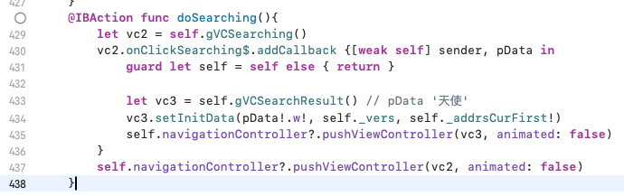
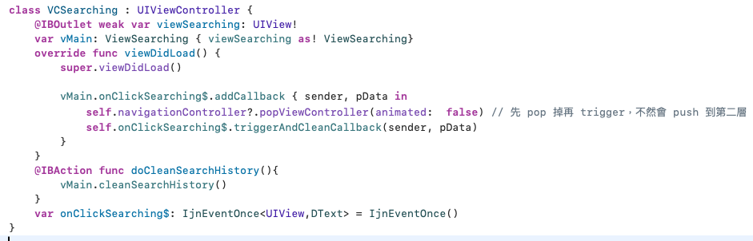

#  Search

## 進入點

- Search 的進入點，直覺是在這個資料夾，但不是
- 進入點是 VCRead 裡面有個 doSearch 的 click func
  - 按下後，會先使用 VCSearching.swift。這個就是簡單的「關鍵字 TextBox」，然後下面就是可以點選的「搜尋記錄」
  - VCSearching 可以理解為，只是選一個「關鍵字」，然後再回到 VCRead，然後又馬上使用 VCSearchResult.swift
  - 真正的負責顯示結果繪圖的就是 VCSearchResult.swift 了

其中的 doSearching 的事件，這樣觸發

## 繪圖事件

- VCSearchResult 關鍵事件 _onSearchResultChanged$
- 在 viewDidLoad 時，會 subscribe 這個事件
- 在 _searchAsync 時，完成時，會 trigger 這個事件
- 疑？按下 filter 之後，是重新搜尋還是 filter (隱藏某些而已)
  - 首先，api 結果，會存到 _searchResult
  - 但不會馬上用到 tableview 介面，真正會用到的是 _dataForTable。
  - 即 (api) -> _searchResult -> (藉 DataForDrawTable 轉換) -> _dataForTable

## ViewDisplayTable2

- 繪圖核心是這個 class
- 這個核心與 Read 是共用同個核心
- 雖 setInitData 會傳入 data，但傳入的不是包含經文的資料，而是章節位置而已，是在裡面再另外取得經文與設定，所以當我們要改資料，還是得到 class 裡去看。
- tracing code
  - 它本質是個 table view
  - 承上，所以設定資料從 tableView cellForRowAt 開始
  - 承上，可以看到 setRowViewWhenReuseCell
    - 字眼 `_modeDraw == .ModeOrig` 正如上面所說， VCRead 與 VCSearchResult 都用這個，所以模式有 2 個。 Orig 應該就是指 `原本的` 就是閱讀
    - `_set_viewrow` 可以看得出來是真正把資料設定的函式，到處充滿著這個函式。
  - 似乎 `_tryQueryDataThenUpdate` 是重要的。當沒資料的時候，它會去查詢經文。
    - 從這個函式可知，它有優化，他不是只查一節經文 (因為這個函式是 cellForRow ， 理論上是處理單一節就好，但它查詢卻是同時查多節經文)
    - 從 `iQ.datas` 字眼，大概可以推論出，資料是都放在這裡面。
    - r1.0 與 r1.1 分別是 DText 與 DText[][]，而 DText 就可以用 .w 來 debug
  - `iQ` 從 `VCSearchResult` 的使用來看，就是 `_drawDataView ()` 時呼叫，第 1 個參數就是 iQ 的實體
    - 實體是 `DataForDrawTable` class，這個 class 當搜尋的 Opt 切換、或 譯本 切換時，都要重新 new 一個。
    - `queryDataAsync` 是查詢經文的函式，會查多個。 row 是 0-based。

